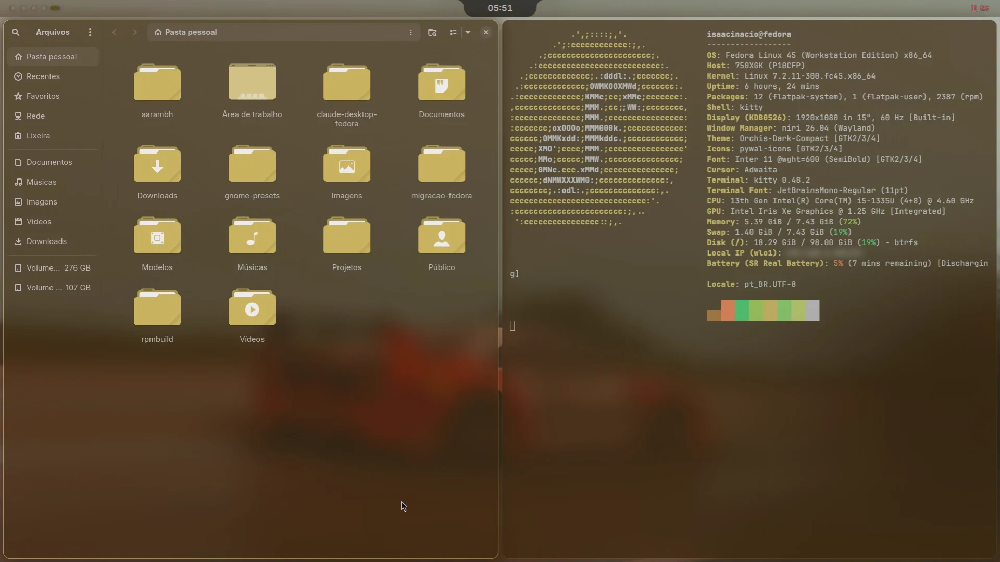
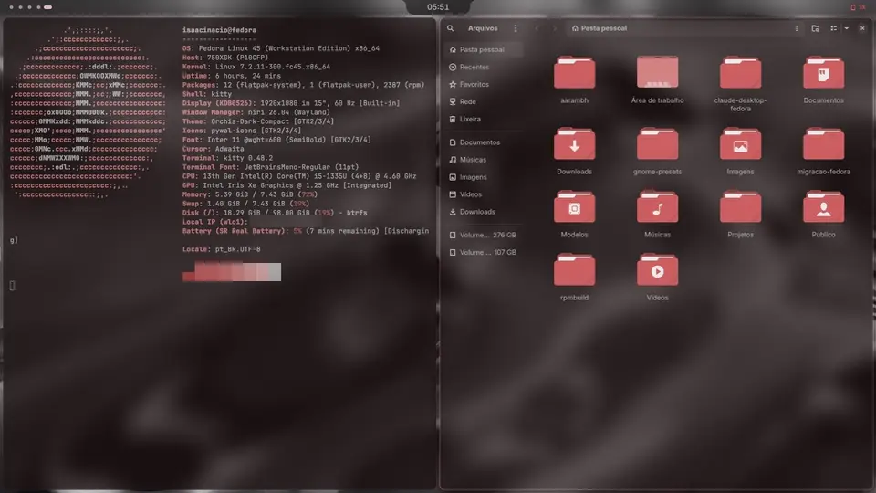
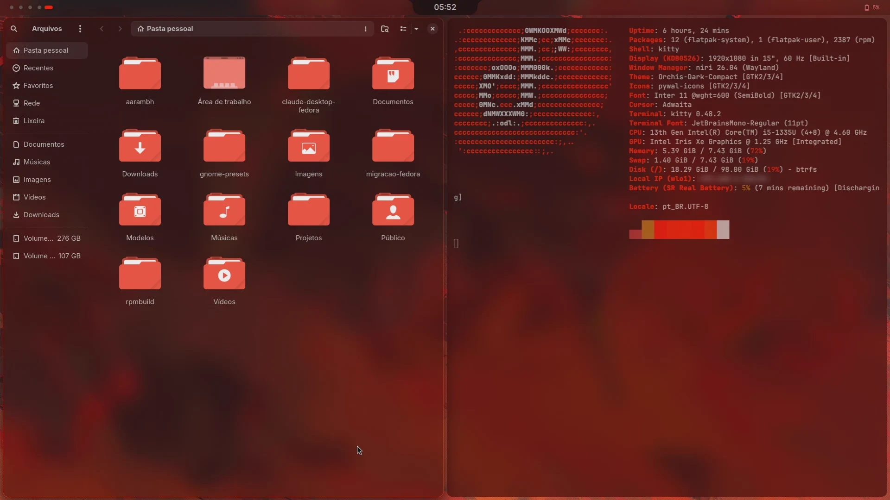
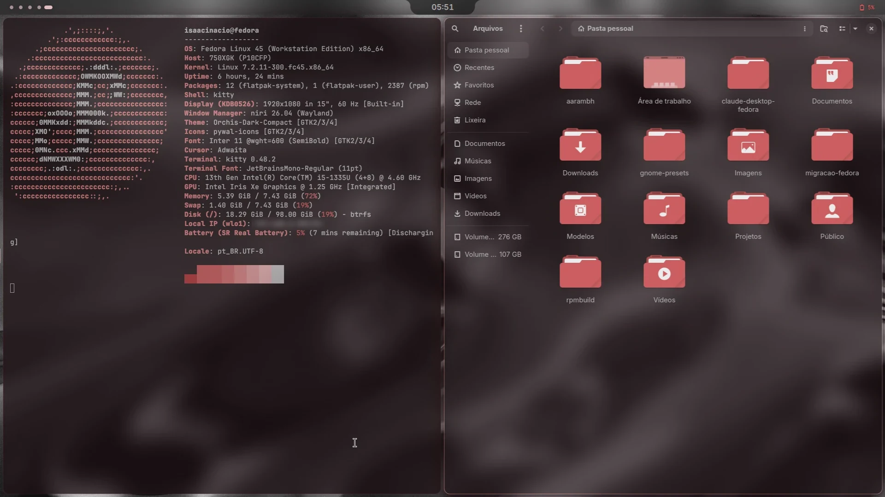
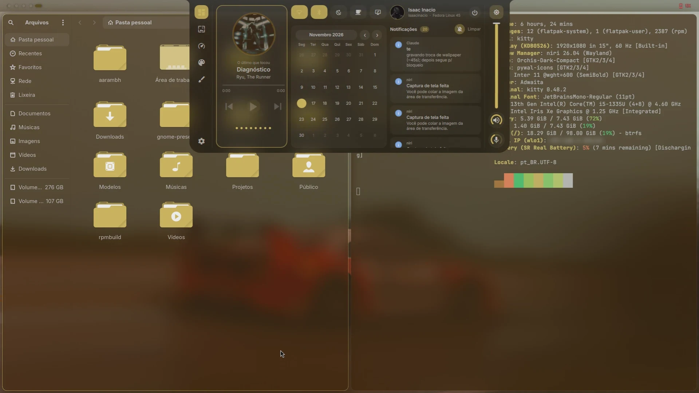
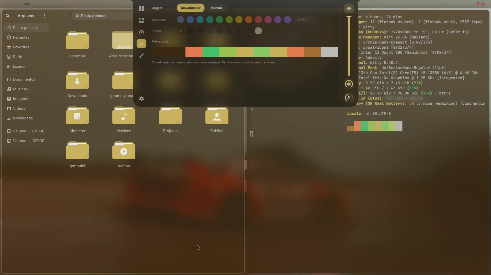
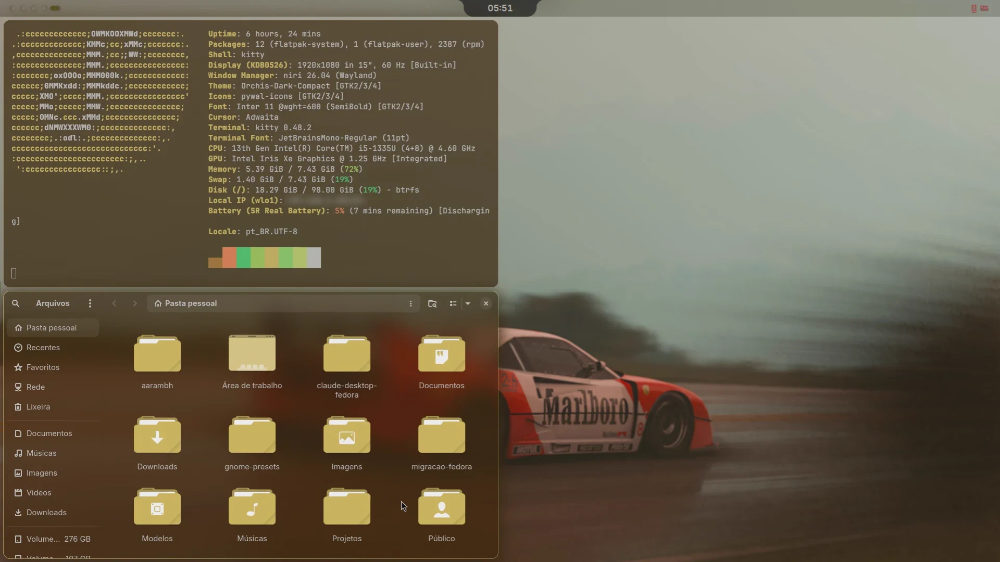
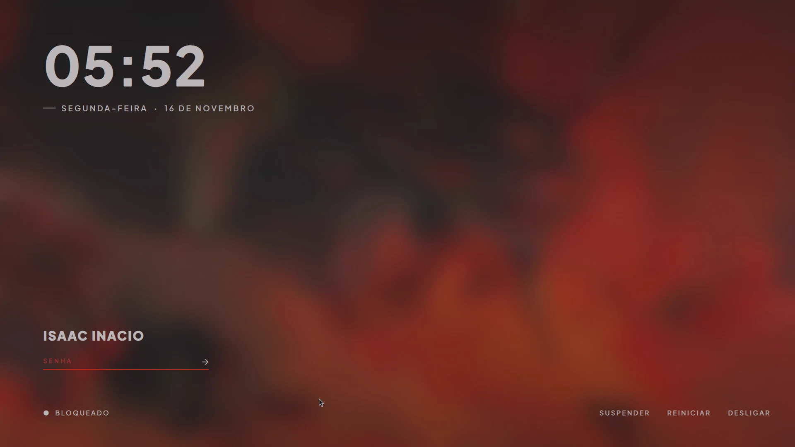

<div align="center">

# glasstty

**A glassy, wallpaper-driven desktop for [niri](https://github.com/YaLTeR/niri) on Fedora.**

Quickshell notch · pywal colours everywhere · translucent windows

[](https://github.com/Isaaacz/glasstty/actions/workflows/checks.yml)

[Changelog](CHANGELOG.md) · [Technical details (pt-BR)](docs/DETALHES.md)



</div>

## One wallpaper, one palette

Pick a wallpaper and the whole desktop follows it, live: the notch, window
borders, the terminal, GTK apps (backgrounds **and** folder icons), Spotify,
VS Code, the login and the lock screen. No app has to be reopened.

<div align="center">

</div>

<table>
  <tr>
    <td></td>
    <td></td>
  </tr>
</table>

## Features

- **Notch shell (Quickshell):** clock, media with a cava visualiser, notifications, OSDs, launcher (`Ctrl+Space`), workspace map.
- **Control Centre (`Super+D`):** quick toggles, player, calendar, a wallpaper grid, system gauges, colours and a page to save and switch whole looks ("rices").
- **Palettes per wallpaper:** each wallpaper offers several palettes (vivid, soft, from one part of the picture, complementary, light…); click any colour to change it. The choice is remembered for that wallpaper.
- **Glass:** every window is slightly translucent with the wallpaper blurred behind it; the terminal and GTK apps use real translucent backgrounds with sharp text. Steam games open fullscreen and stay fully opaque.
- **Live theming:** pywal palette pushed to GTK 3/4 (incl. libadwaita), Qt, kitty, Spotify (Catppuccin layout via spicetify), VS Code and the folder icons, all without restarting apps.
- **Login and lock:** SDDM with the [thyx](https://github.com/rccyx/thyx) theme and a matching lock screen, both following the wallpaper. Twelve layout styles (some inspired by [qylock](https://github.com/Darkkal44/qylock)) and options for the clock, password, blur and more, with a live preview; blur, side, height and clock format reach the login too. When idle, the screen fades to dark for 20 s before it locks. Low battery warns at 20, 10 and 5 %.
- **Settings:** window effects (transparency, blur, gaps, border, shadow, animations), notch, bar and lock screen. Appearance changes show live and are kept with *Apply*, or undone with *Discard*.
- **Exit screen (`Super+Shift+E`):** a full-screen, blurred goodbye with lock, suspend, log out, restart and shut down.
- **Rices:** `rice salvar NAME` / `rice usar NAME` store and switch complete looks (shell settings, icons, login layout, wallpaper) as git branches.
- **GNOME stays untouched:** everything is scoped to the niri session; GNOME keeps its own theme and settings.

<table>
  <tr>
    <td></td>
    <td></td>
  </tr>
  <tr>
    <td></td>
    <td></td>
  </tr>
</table>

## Keybindings

| Keys | Action |
|---|---|
| `Super+D` | Control Centre |
| `Ctrl+Space` | Launcher |
| `Super+W` | Wallpaper picker |
| `Super+T` / `Super+E` | Terminal (kitty) / Files |
| `Super+←/→/↑/↓` | Move focus |
| `Super+Shift+←/→` | Move the window left / right |
| `Super+Alt+←/→` | Stack / unstack the window with its neighbour |
| `Super+J` | Cycle the column width (⅓ · ½ · ⅔ · full) |
| `Super+F` / `Super+Shift+F` | Maximise to the edges / fullscreen |
| `Super+Shift+Tab` | niri Overview |
| `Super+1…0` | Workspaces |
| `Super+L` | Lock |
| `Super+Shift+E` | Exit screen (log out, restart, shut down) |
| `Super+Shift+S` / `Print` | Capture screen: area, screen or window, photo or video (GNOME-style) |
| `Super+,` | Shell settings |
| `Super+K` | Every shortcut, read live from `config.kdl` |

## Install

Tested on **Fedora 45** with **niri 26.04** and **Quickshell 0.3**.

```bash
git clone https://github.com/Isaaacz/glasstty.git ~/Projetos/glasstty
cd ~/Projetos/glasstty
./install-niri.sh
```

The script enables the Quickshell COPR, installs the packages in
`packages/fedora-niri.txt` (asks for sudo once) and pywal with `pipx`, symlinks
the configs into `~/.config` (your own files are backed up as `*.bak-<date>`)
and copies the wallpapers to `~/Pictures/wallpapers`. Log out and pick **niri**
on the login screen.

`./install-niri.sh --dry-run` shows every step without changing anything, and
`./uninstall-niri.sh` undoes it all, putting your backed-up files back.

Optional extras, each documented in [docs/DETALHES.md](docs/DETALHES.md):
the SDDM/thyx login (`./sddm-thyx.sh`), Spotify theming (spicetify) and
VS Code theming.

## Credits

glasstty started as a niri port of [pocket-dots](https://github.com/diegoMalagrida/pocket-dots)
by Diego Malagrida, and much of the shell and scripts still comes from it, so
the project keeps its licence: **GPL-3.0** (see [LICENSE](LICENSE)).
Spotify theme: [Catppuccin for spicetify](https://github.com/catppuccin/spicetify) (MIT).
Login theme: [thyx](https://github.com/rccyx/thyx) (MIT).
